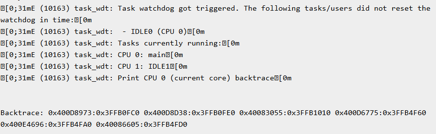

# Relatório de Sistemas Embarcados - Semana 4

##  Integrantes
* Alexandre de Oliveira Júnior
* Luisa Martins Schineider
* Miguel Arcanjo N. Meriguete

---

## Entregas

### 1. Tabela com as 10 latências da Parte A + média e máximo, com a explicação capturar × processar (≤ 5 linhas).
| Amostra | Latência de Captura (ms) | Latência de Processamento (ms) |
| :---: | :---: | :---: |
| **1** | 2,9 | 103,1 |
| **2** | 3,0 | 99,4 |
| **3** | 2,8 | 104,6 |
| **4** | 3,1 | 100,8 |
| **5** | 3,3 | 105,2 |
| **6** | 2,7 | 98,9 |
| **7** | 3,1 | 102,8 |
| **8** | 2,5 | 101,2 |
| **9** | 3,3 | 102,5 |
| **10** | 2,8 | 101,5 |
| **Média** | **2,95 ms** | **102,00 ms** |
| **Máximo** | **3,30 ms** | **105,20 ms** |

Capturar: é a função da ISR, que detecta o evento e responde em microssegundos (µs), com baixa latência garantida pela resposta do hardware.  
Processar: é a função da tarefa, que identifica o flag quando o escalonador permite sua execução. Sua latência inclui o vTaskDelay do laço, podendo ser maior que a da ISR.

---
### 2. Resposta do item 8: cenário numérico em que o polling do Lab 3 perderia eventos.

O polling não conseguiria contar corretamente os pulsos do encoder, pois seu intervalo de verificação (10 ms) é dez vezes maior que o período dos pulsos (1 ms). Dessa forma, perderia aproximadamente 9 dos 10 pulsos (90%).

---
### 3. Prints das duas falhas da Parte C (erro do printf-na-ISR e mensagem do task_wdt) + a explicação da cadeia do WDT.

erro do printf-na-ISR


mensagem do task_wdt



O erro ocorreu porque uma tarefa executou um laço de repetição sem nenhum bloqueio ou pausa, impedindo que outras tarefas do sistema fossem executadas normalmente.

O laço sem bloqueio mantém a CPU ocupada continuamente, impedindo que a tarefa IDLE seja executada. Como a IDLE não consegue rodar, também não consegue alimentar o watchdog timer. Quando o tempo limite é ultrapassado, o WDT identifica a falha e apresenta o aviso no terminal.

---

### 4. Código da Parte D (a ISR modificada e a `gerador_task`) + três leituras de duração comparadas aos valores programados (150 ms / 1200 ms).
```c
#include <stdio.h>
#include <inttypes.h>
#include "freertos/FreeRTOS.h"
#include "freertos/task.h"
#include "driver/gpio.h"
#include "esp_timer.h"

#define LED GPIO_NUM_2
#define IN_PIN GPIO_NUM_4
#define OUT_PIN GPIO_NUM_18

static volatile uint64_t s_t1 = 0, s_duracao_us = 0;
static volatile uint32_t s_contador = 0;
static volatile bool s_nova_medicao = false;

static void heartbeat_cb(void *arg) {
    static int nivel = 0;
    gpio_set_level(LED, nivel ^= 1);
}

static void IRAM_ATTR gpio_isr_handler(void* arg) {
    uint64_t agora = esp_timer_get_time();
    if (gpio_get_level(IN_PIN) == 0) {
        s_t1 = agora;
    } else if (s_t1 > 0) {
        s_duracao_us = agora - s_t1;
        s_contador++;
        s_nova_medicao = true;
        s_t1 = 0;
    }
}

void gerador_task(void *pvParameters) {
    while (1) {
        vTaskDelay(pdMS_TO_TICKS(1000));
        gpio_set_level(OUT_PIN, 0);
        vTaskDelay(pdMS_TO_TICKS(150));
        gpio_set_level(OUT_PIN, 1);

        vTaskDelay(pdMS_TO_TICKS(1000));
        gpio_set_level(OUT_PIN, 0);
        vTaskDelay(pdMS_TO_TICKS(1200));
        gpio_set_level(OUT_PIN, 1);
    }
}

void leitor_task(void *pvParameters) {
    while (1) {
        if (s_nova_medicao) {
            s_nova_medicao = false;
            printf("Pulso #%" PRIu32 " | Duracao: %" PRIu64 " us (%.2f ms)\n",
                   s_contador, s_duracao_us, s_duracao_us / 1000.0);
        }
        vTaskDelay(pdMS_TO_TICKS(50));
    }
}

void app_main(void) {
    gpio_reset_pin(LED);     gpio_set_direction(LED, GPIO_MODE_OUTPUT);
    gpio_reset_pin(OUT_PIN); gpio_set_direction(OUT_PIN, GPIO_MODE_OUTPUT); gpio_set_level(OUT_PIN, 1);
    gpio_reset_pin(IN_PIN);  gpio_set_direction(IN_PIN, GPIO_MODE_INPUT);
    gpio_set_pull_mode(IN_PIN, GPIO_FLOATING);
    gpio_set_intr_type(IN_PIN, GPIO_INTR_ANYEDGE);

    gpio_install_isr_service(0);
    gpio_isr_handler_add(IN_PIN, gpio_isr_handler, NULL);

    const esp_timer_create_args_t timer_args = { .callback = heartbeat_cb, .name = "heartbeat" };
    esp_timer_handle_t timer;
    esp_timer_create(&timer_args, &timer);
    esp_timer_start_periodic(timer, 500000);

    xTaskCreate(gerador_task, "gerador", 2048, NULL, 5, NULL);
    xTaskCreate(leitor_task, "leitor", 2048, NULL, 5, NULL);
}
```
Tabela de leituras de comparação
| Leituras | Pulso Programado | Valor Lido na ISR (Firmware) | Valor no PulseView / Analisador | Desvio (Jitter) |
| :---: | :---: | :---: | :---: | :---: |
| **1** | 150 ms (150.000 µs) | 150.036 µs (150,04 ms) | 150,03 ms | +0,03 ms |
| **2** | 1200 ms (1.200.000 µs) | 1.200.064 µs (1200,06 ms) | 1200,06 ms | +0,06 ms |
| **3** | 150 ms (150.000 µs) | 150.018 µs (150,02 ms) | 150,02 ms | +0,02 ms |

---
### 5. Parágrafo final: por que `printf` dentro da ISR é proibido e **como** o firmware contorna (flag `volatile` lida pela tarefa)?

Não se deve chamar o printf dentro de uma ISR porque ela precisa executar e terminar o mais rápido possível. Como o printf formata strings e envia dados pela serial de forma lenta e bloqueante, usá-lo ali dentro atrasa o sistema, pode causar estouro de pilha ou até reiniciar o microcontrolador pelo Watchdog Timer. Para resolver isso, a ISR faz apenas o essencial: guarda os valores em variáveis globais marcadas como volatile e levanta uma flag booleana avisando que há uma nova leitura. Depois, a leitor_task detecta essa flag e faz a impressão na tela normalmente, sem comprometer a precisão das medições.